# es-coach-skills — Claude Code Skills for Japanese Job-Hunting (Shukatsu) ES Coaching

**English** | [简体中文](README.zh.md) | [日本語](README.md)

A four-skill set for [Claude Code](https://claude.com/claude-code) that automates ES (entry sheet / cover letter) and interview preparation for Japanese new-graduate recruiting (`就活`/shukatsu). It distills successful patterns from offer-holders' experience, uses that as grounds to critique your ES, cross-checks company philosophy / desired-candidate profiles via structured company research reports, and folds all of it into a pre-interview prep report.

> This is the skill layer extracted from a personal job-hunting automation project. It contains none of your ES content, target companies, or vault data — everything accumulates in your own Obsidian vault.

## How the four skills relate



| Skill | Role |
|-------|------|
| `es-coach` | Interactive ES critique (fact-check → 5-axis scoring → revision loop → sign-off). Grounded in distilled knowledge, the company report, and your own past episodes |
| `shukatsu-distill` | Three modes: `ingest` (bring in offer-holders' accounts), `distill` (extract success patterns), `grill` (reverse-interview to turn your own experience into material) |
| `kigyou-report` | Turns a named company into a fixed 12-section structured report (org/division map, company philosophy, ES tactics, etc.) |
| `mensetsu-report` | Given company × division × interview stage, merges distilled knowledge, the company report, your submitted ES and past interview records into one prep sheet: question bank, answer outlines, reverse questions, recurring weaknesses (replaces the retired interactive mock interview) |

All four read and write an Obsidian vault; every vault path resolves through `vault.paths.env`, a **single registry file** (so reorganizing your vault never requires editing skill prose).

## Three ways to use it (heavier = smarter)

| | Needs | What you get |
|---|---|---|
| **① Portable** | A browser | Copy [portable/es-coach-portable.md](portable/es-coach-portable.md) into ChatGPT / Claude / Gemini. ES critique only, grounded in general job-hunting conventions. Start here |
| **② Plugin** | Claude Code | Installs all four skills via `/plugin`. Only the vault config is manual |
| **③ Clone** | Claude Code + git | For people who want to modify it. Same content as ② |

② and ③ accumulate data in your Obsidian vault, so critique history, company research and interview prep connect to each other.

### ① Portable (no install)

Copy the contents of [portable/es-coach-portable.md](portable/es-coach-portable.md) into whatever AI you already use.

What it cannot do: cross-check against past critiques, match against company philosophy, tie into your own experience inventory, count characters mechanically. For those, use ②.

### ② Plugin (Claude Code, recommended)

```
/plugin marketplace add jiayi-ThE-CREATOR/es-coach-skills
/plugin install shukatsu@es-coach-skills
```

Then run setup once, to point the skills at your vault:

```bash
bash ~/.claude/plugins/cache/es-coach-skills/shukatsu/*/setup.sh
```

(The first run creates `~/.config/shukatsu-skills/vault.paths.env` and stops. Set `VAULT_ROOT` to your vault, then run the same command again.)

Plugin skills are namespaced — invoke them as `/shukatsu:es-coach`.

## Requirements

- [Claude Code](https://claude.com/claude-code) (Skills feature)
- Obsidian (or an equivalent Markdown vault)
- Python 3 (needed to run `tools/count_chars.py` and `tools/experience_inventory_sync.py`; requires `pyyaml`)

## ③ Clone (for people who want to modify it)

```bash
# 1. Clone
git clone <this-repo-url> es-coach-skills
cd es-coach-skills

# 2. Point an env var at this repo (add to your shell startup file)
echo 'export SHUKATSU_SKILLS_ROOT="'"$(pwd)"'"' >> ~/.zshrc
source ~/.zshrc

# 3. Run setup (the first run just creates vault.paths.env and stops)
./setup.sh
$EDITOR vault.paths.env   # point VAULT_ROOT at your actual Obsidian vault

# 4. Run it again — this creates folders, drops the seed, links the skills
./setup.sh

# 5. Python dependency
pip install pyyaml
```

`setup.sh` is idempotent (it never overwrites existing files). `./setup.sh --check` reports the current state without writing anything. It does:

| Step | What |
|---|---|
| Create vault folders | `mkdir -p` every path in `vault.paths.env`. **Without this the very first run breaks** |
| Drop the seed | Installs `seed/全行業共通.md` only when you have no knowledge files yet (see below) |
| Link the skills | Symlinks all four skills into `~/.claude/skills/` |
| Check deps | python3 / pyyaml |

### About the seed knowledge file

These skills are only as good as the distilled-knowledge files behind them. But starting from literally nothing breaks their core premise — grounding critique in offer-holder patterns — so the repo ships `seed/全行業共通.md`, an initial file written **purely from public, widely-known Japanese job-hunting conventions**, with `source_count: 0`.

- Seed lines carry no citation. **Only lines with a `[出典: ...]` citation come from material you ingested** — the skills read the difference and explicitly say "as general job-hunting knowledge" when leaning on seed content.
- The more you run `/shukatsu-distill ingest`, the more cited lines accumulate, and the grounding shifts from generic advice toward the companies you are actually targeting.

After setup, start with `/shukatsu-distill ingest` in Claude Code (feed it offer-holders' stories, YouTube transcripts, job-hunting site articles → auto-distilled → critique your ES with `/es-coach`).

## Usage

```
/shukatsu-distill ingest      Bring in offer-holders' accounts/articles as raw material
/shukatsu-distill distill     Extract success patterns from material into distilled knowledge
/shukatsu-distill grill       Reverse-interview to dig up and materialize your own experience
/kigyou-report <company>      Generate a company research report
/es-coach                     Interactive ES critique
/mensetsu-report <company>    Generate a pre-interview prep report
```

## Sample output

`examples/` holds fabricated-data samples so you can see actual output shape without first setting up a vault:

| File | Content |
|------|---------|
| [examples/es-coach-sample-critique.md](examples/es-coach-sample-critique.md) | Full critique report for a fictional ES |
| [examples/shukatsu-distill-sample-chishiki.md](examples/shukatsu-distill-sample-chishiki.md) | What a distilled-knowledge file looks like after `distill` runs |
| [examples/kigyou-report-sample-excerpt.md](examples/kigyou-report-sample-excerpt.md) | Company report excerpt (of the full 12 sections) |

## Repository layout

```
es-coach-skills/
├── skills/
│   ├── es-coach/SKILL.md            Interactive ES critique (Phase 0–8 flow)
│   ├── shukatsu-distill/SKILL.md    ingest / distill / grill (3 modes)
│   ├── kigyou-report/
│   │   ├── SKILL.md                 Company report generation (fixed 12 sections)
│   │   └── references/              Formatting rules & division-section template (read on demand)
│   └── mensetsu-report/SKILL.md     Interview prep report (question bank, answer outlines)
├── tools/
│   ├── count_chars.py               ES character/word counter (offloads counting from the LLM)
│   ├── experience_inventory_sync.py Recomputes episode usage from critique logs
│   └── vault_paths.py               Resolver for vault.paths.env
├── portable/es-coach-portable.md    Portable version (single copy-paste file)
├── examples/                        Fabricated-data sample output (table above)
├── .claude-plugin/                  plugin / marketplace manifests
├── seed/全行業共通.md               Starter distilled knowledge (public info; installed by setup.sh)
├── setup.sh                         Creates folders, drops the seed, links skills (idempotent)
├── vault.paths.example.env          Vault path registry template
└── README.md / README.zh.md / README.en.md
```

## How material actually accumulates (two supply paths)

This system doesn't get smarter by itself — you drive two loops that grow the distilled knowledge and personal-experience material inside the vault pointed to by `vault.paths.env`. This repo contains only the logic (skill prompts and helper scripts); none of your actual company-selection content or ES data.

### ① Personal experience (`素材/本人/`) — run `grill`, or keep a diary yourself

- The easiest path is `/shukatsu-distill grill`: Claude reverse-interviews you and extracts material.
- Keeping a regular **diary/journal in Obsidian** is also a valid supply path — jot down self-analysis, gakuchika candidates, shifts in values, unpolished.
  - For `distill` mode to pick these up automatically, copy the relevant diary passages into a file under `VAULT_SHUKATSU_SOZAI_SELF` (`素材/本人/`) with the same frontmatter `grill` output uses (`source_type: 本人`, `distilled: false`, etc.) — `distill` finds new material by grepping for `distilled: false`.
  - Without that frontmatter, `es-coach`'s Phase 4 will still `ls` and read `素材/本人/` directly, but `distill` won't fold it into the knowledge files.

### ② Offer-holder patterns (distilled knowledge) — run `shukatsu-distill ingest` to pull in web material

- Feed `/shukatsu-distill ingest` a YouTube URL, a job-hunting site article URL, or pasted text; it fetches the content via defuddle/WebFetch and saves it under `素材/YouTube/` or `素材/就活サイト/`.
- Saving **automatically triggers `distill` mode without asking**, folding success patterns into the knowledge files (e.g. `蒸留知識/内定之路/金融.md`).
- In practice: every time you find an offer-holder's YouTube video or article, run `ingest` on it.

## License

MIT. See `LICENSE`.
