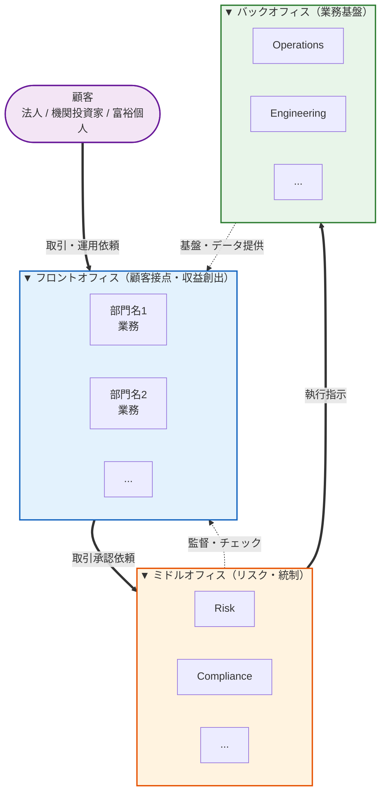
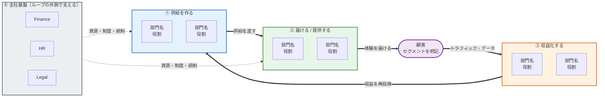
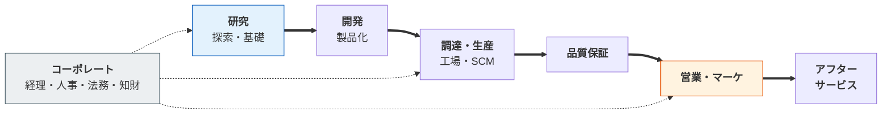
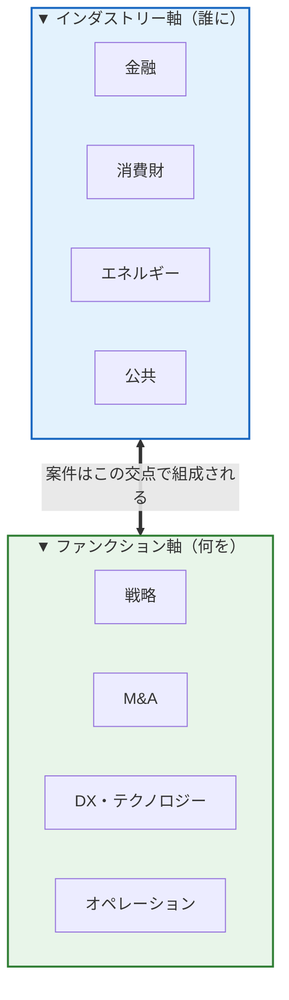

# セクション 4「部門・職種マップ」の必須フォーマット（最重要）

セクション 4 は **このレポートの中核**。**X.0 として「全体概観図」を最初に置き**、その後で各部門ごとのサブセクションに展開する。

---

## X.0 部門全体概観図（必ずセクション冒頭に配置）

情報源は **対象企業の公式「Divisions」「Our Businesses」「Teams」ページ**を優先する。

> [!danger] 生 HTML をコンテキストに読み込まない
> 企業サイトの生 HTML は **1 ページ 60〜75 万字（20 万トークン超）**あり、そのうち可読テキストは **1% 程度**。残りは `<script>`・インライン CSS・ハッシュ化された class 名で、しかもトークン効率が通常の文章の半分（実測 3.3 字/token 対 5.7 字/token）。**1 ページ読むだけでコンテキストが埋まり、以降の調査も執筆もできなくなる。**
>
> したがって：`curl` の出力をそのまま読まない。`WebFetch` の生 HTML を貼らない。どうしても `curl` を使うなら **シェル側で `grep -oE` 等に必ずパイプし、抽出結果だけを受け取る**（出力が数百行を超えそうなら諦めて別手段へ）。

### 公式ページの取得手順（上から順に試し、成功した時点で止める）

1. **URL は検索で特定する。ハードコードした URL を使わない** — 企業サイトは改編が多く、古い URL は失効する（実際、以前ここに書いていた GS の 3 つの URL は現在すべて本文を取得できない）。
   `WebSearch` に `<企業名 英語> divisions our businesses careers` 等を投げ、現行の部門一覧ページを特定する。
2. **`WebFetch` でそのページを読む**（基本手段）。サーバ側で本文抽出されるので、生 HTML を持ち込まずに済む。
3. **`defuddle parse "<URL>" --md`**。ただし defuddle は「記事本文」を探す設計で、**カード型の企業マーケティングページでは 0 字を返すことがある**。数百字未満なら失敗とみなして次へ。
4. どれも取れない場合は、**WebSearch のスニペット＋ IR 資料（有価証券報告書・アニュアルレポートの事業セグメント）から部門構成を再構成**し、出典コールアウトに「公式部門ページを取得できず、IR 資料と報道から再構成」と明記する。

### 構造モデルは業界ごとに選ぶ（最重要ルール）

> [!danger] フロント / ミドル / バックを機械的に当てはめない
> **3 層（フロント / ミドル / バック）は「外資金融の組織原理」であって、汎用テンプレではない。** 事業会社・プラットフォーム・コンサル・メーカーに無理やり当てはめると、**「その会社を実際に動かしている論理」が図から消える**（例：Amazon を 3 層にすると、部門が「フライホイールのどこを回しているか」という最重要の構造が見えなくなる）。
>
> **必ず先に問うこと：「この会社の部門は、何を軸に並んでいるのか？」** その軸をそのまま図の軸にする。

**モデル選択の指針**（あくまで出発点。当てはまらなければ自分で設計する）：

| 業界 / 会社の型 | 推奨モデル | 図の軸になるもの |
|---|---|---|
| 外資投資銀行・証券・信託 | **3 層（フロント / ミドル / バック）** | 収益創出 → リスク統制 → 執行基盤という**規制産業の統制構造** |
| EC・プラットフォーム（Amazon、楽天、メルカリ等） | **フライホイール / 循環型** | 品揃え → 体験 → トラフィック → 収益化 → 再投資という**自己強化ループ** |
| メーカー・素材・製薬 | **バリューチェーン型（左→右の一方向）** | 研究 → 開発 → 調達 → 生産 → 品質 → 販売 → アフター |
| 総合商社 | **営業本部（縦）× コーポレート（横）のマトリクス** | 事業領域別の縦割り＋横断機能 |
| 戦略コンサル・FAS | **インダストリー × ファンクションのマトリクス** | 「誰に」×「何を」の 2 軸。階層ではない |
| 外資 IT 販社（Dell、Salesforce 等） | **顧客ジャーニー型** | 需要創出 → 商談 → 導入 → 定着・拡大（Land & Expand） |
| SIer・受託開発 | **プロジェクトライフサイクル型** | 提案 → 要件定義 → 設計開発 → 運用保守 |
| 日系メガバンク・保険 | 3 層 or **顧客セグメント × 商品のマトリクス** | 規制構造が強ければ 3 層、営業構造が強ければマトリクス |

**図の良し悪しの判定基準**（生成後に必ず自己チェック）：

- [ ] この図を見て、**「この会社は何で儲けているか」**が分かるか
- [ ] この図を見て、**「部門同士がなぜその順番/関係で並ぶのか」**が説明できるか
- [ ] 就活生が **「自分が受ける部門はここだ」**と指させるか
- [ ] **その業界特有の言葉**（フライホイール、バリューチェーン、Land & Expand 等）が図の構造そのものに反映されているか
- [ ] 3 層モデルを使う場合、**それがこの会社の実態だからであって、テンプレだからではない**と言えるか

### モデル A：3 層（フロント / ミドル / バック）— 規制産業・投資銀行向け

| レイヤー | 判定基準 | 代表例 |
|---------|---------|--------|
| フロント | 顧客接点があり、収益を直接生む | IBD、Markets、Research、Asset Management |
| ミドル | リスク・統制・規制対応を担う | Risk、Compliance、Controllers、Legal、Audit |
| バック | 実行・基盤・人事を担う | Operations、Engineering、Finance、HR、Real Estate |

**Mermaid テンプレ**（部門名のみ差し替え）。プレビュー: [assets/kigyou-report-orgchart-template.svg](../../../assets/kigyou-report-orgchart-template.svg)（GitHub 上でこのコードブロックがライブ Mermaid として描画されない場合があるため、静止画も置いている。Obsidian にコピーする分にはこの下の生テキストをそのまま使う）：



### モデル B：フライホイール / 循環型 — EC・プラットフォーム向け

部門を階層ではなく **「自己強化ループのどの区間を回しているか」** で並べる。ループが閉じていることが図の生命線なので、**最後のブロックから最初のブロックへ必ず矢印を戻す**こと。



### モデル C：バリューチェーン型 — メーカー・素材・製薬向け

左から右への一方向の流れ。**上流ほど不確実性が高く、下流ほど顧客に近い**という軸を明示する。



### モデル D：マトリクス型 — コンサル・商社向け

**縦（誰に＝インダストリー / 営業本部）× 横（何を＝ファンクション / 機能）** の 2 軸。階層関係にしないこと。



---

**続けて必須**：
- **部門一覧テーブル**：全 N 部門を「**採用したモデルの区分名** / 部門名 / 公式説明 1 行要約」の 3 列で列挙。列名は 3 層モデルなら「レイヤー」、フライホイールなら「ループ区間」、バリューチェーンなら「工程」など、**図と同じ言葉を使う**（図と表で用語がズレると読者が迷子になる）
- **協働シナリオ 3 例**：`> [!example]` で「主要な業務（M&A、トレード、大型セール、新製品投入、新拠点立ち上げ等）が部門間をどう流れるか」を矢印付き 1-2 行で示す
- **就活生視点 tip**：図全体から読み取れる戦略的示唆を 3-4 点

---

## X.1 以降：各部門サブセクション

X.0 の後で、各部門ごとに **1 つの独立サブセクション**を作り、以下の構造を厳守する：

```markdown
### 4.X 部門名（英略 / 正式英名）

> [!quote] 公式（goldmansachs.com 等の正式ソース）
> **<原文（英語）の主要パラグラフをそのまま引用>**

> [!quote] 公式 — <サブテーマ>（任意：ランキング、業績、サブ部門説明等）
> **<追加引用>**

**業務の本質**（1-2 段落、私の補足解釈）：<業務内容、収益源、組織内位置づけ>

#### サブ業務 / プロダクト領域

| 領域 | 内容 / 公式引用 |
|------|---------------|
| <サブ1> | "<公式短文引用 or 私の説明>" |
| <サブ2> | ... |

**日本拠点の特性**（任意）：<日本特有の事情、リーダー名、最近の組織変動>

> [!tip] 就活生視点
> <この部門を志望するうえでの 1-3 文の助言>
```

## 引用ルール

- **公式引用 ≥ 解説**：1 サブセクション内で **引用ブロックの行数 ≥ 私の解説の行数**
- **原文優先**：英語ソースは英語のまま `**bold**` で引用、日本語意訳は補足としてカッコ書き
- **出典明示**：各 `> [!quote]` の冒頭に「公式（goldmansachs.com / <ページ名>）」と明記
- **改変禁止**：引用文の語句を改変せず、省略する場合は `...` を使う
- **複数ソース**：同じ部門に対し公式・業界紙・社員ブログなど複数ソースがあれば、全て引用ブロックで並列

## どのページを取りに行くか

**ページ数に上限を設ける**：まず「部門一覧ページ 1 枚」を取り、そこに各部門の説明が 1〜2 段落あるなら**それで足りる**。個別部門ページまで取りに行くのは、一覧の記述が薄すぎて業務内容が書けない部門だけ、**多くても 3 ページまで**。「全部門の専用ページを揃える」ことを目的にしない——部門が 10 ある企業で全ページ取ると、それだけで調査予算を使い切る。

取得は上の「公式ページの取得手順」に従う（WebSearch で URL 特定 → `WebFetch`）。**URL をここに書き溜めない**（企業サイトの改編で必ず腐る）。

日本語公式ページは取得困難な場合がある → **グローバル英語ページを優先**。

## 部門サブセクションの後に必須

- **3.X 部門サマリー比較表**：全部門を 1 つの表で横断比較（顧客 / 収益源 / 新卒倍率 / 数字力 / 英語要求）。**`/es-coach` が志望部門を特定できないときここを読むので、必ず作る**
- **出典コールアウト**：`> [!important] 出典` で「公式英文ページから取得、和訳は補足のため意訳を含む」と明記
